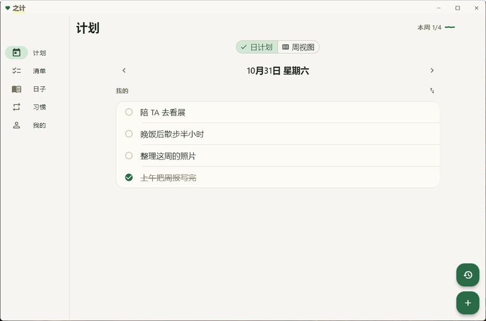
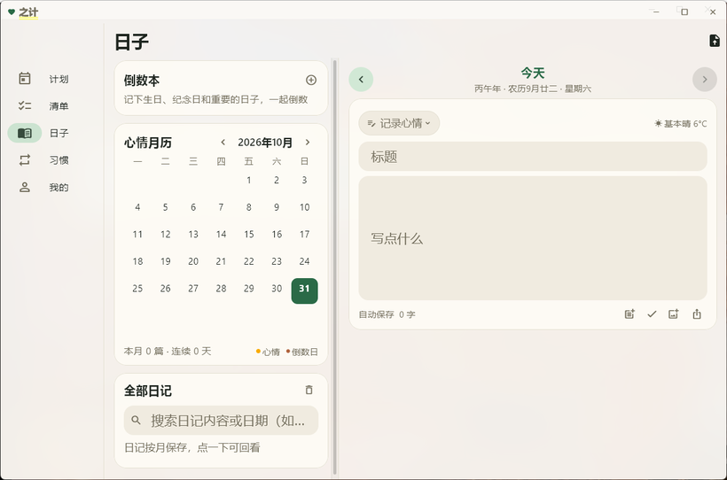

<div align="center">


# 之计

<sub>两个人的手帐风计划应用 · Android + Windows · 自带同步服务端</sub>

[](https://github.com/hauxu/zhiji/releases)
[](#-下载)
[](LICENSE)

[下载](#-下载) · [功能](#-功能) · [构建](#-从源码构建) · [服务端](server/README.md) · [更新日志](assets/CHANGELOG.md)

<br>


</div>

## 这是什么

一个给自己和伴侣一起用的小应用。计划、清单、习惯、日记放在一处，两个人的数据加密同步，
图片始终留在本机。有一个同样简单的同步服务端，用 Python 标准库写完，想自己部署就自己部署。

## 功能

<table>
<tr><td width="120"><b>计划</b></td><td>日视图 / 周视图、重复任务、提醒、置顶、拖动排序，完成的任务自动归档</td></tr>
<tr><td><b>清单</b></td><td>备注、附件、条目日期；可自用，也可共享或与 TA 共同编辑</td></tr>
<tr><td><b>习惯</b></td><td>打卡月历、热力图、每日提醒</td></tr>
<tr><td><b>日子</b></td><td>日记、心情月历、倒数本（支持农历）</td></tr>
<tr><td><b>情侣</b></td><td>扫码配对，共享密钥同步；留言板带已读回执</td></tr>
<tr><td><b>多设备</b></td><td>设备管理、历史分页；换机用恢复码取回数据</td></tr>
<tr><td><b>通知</b></td><td>本地闹钟 + 后台长连接，划掉 App 也能收到</td></tr>
<tr><td><b>外观</b></td><td>中国传统色、深色模式、自定义背景；Windows 支持毛玻璃</td></tr>
</table>

## 截图

<table>
<tr>
<td></td>
<td></td>
</tr>
<tr align="center">
<td><sub>计划 · 日视图</sub></td>
<td><sub>日子 · 日记与倒数本</sub></td>
</tr>
</table>

## 下载

| | 文件 | 体积 |
|---|---|---|
| **Android 7.0+** | [`zhiji-5.16.28.apk`](https://github.com/hauxu/zhiji/releases/download/v5.16.28/zhiji-5.16.28.apk) | 66 MB |
| **Windows 免安装** | [`zhiji-v5.16.28-windows-portable.zip`](https://github.com/hauxu/zhiji/releases/download/v5.16.28/zhiji-v5.16.28-windows-portable.zip) | 40 MB |
| **Windows 安装版** | [`zhiji-5.16.28-windows-setup.exe`](https://github.com/hauxu/zhiji/releases/download/v5.16.28/zhiji-5.16.28-windows-setup.exe) | 36 MB |

国内下载走 <https://www.huaxu.xin/zhiji/>，比 GitHub 快，包一模一样。校验值见 Release 里的 `SHA256SUMS.txt`。

装好之后用应用内的「检查更新」就能升级，不用回来下。

## 从源码构建

<details>
<summary>需要的环境和命令</summary>

<br>

Flutter 3.47（Dart 3.13+）、Android SDK 36 + JDK 17；Windows 还要装 VS2022 的 C++ 桌面负载。

```sh
flutter build apk --release \
  --dart-define=ZHIZI_SYNC_HOST=your.server.com \
  --dart-define=ZHIZI_SYNC_PORT=8443 \
  --dart-define=ZHIZI_SYNC_APPKEY=<服务端 GD_APP_KEY> \
  --dart-define=ZHIZI_SYNC_CERT=<证书 SHA-256 指纹>
```

四个参数指向同步服务器。不填也能跑，只是云同步、配对和检查更新不可用。

证书指纹：

```sh
openssl x509 -in sync.crt -noout -fingerprint -sha256
```

Windows 换成 `flutter build windows --release`，产物在 `build/windows/x64/runner/Release/`。
仓库不带 VC++ 运行库，缺的话把 `vc_redist.x64.exe` 放进 `windows/` 再跑 `install_judging.bat`。

</details>

## 自建同步服务端

<details>
<summary>部署方式</summary>

<br>

`server/server.py` 只依赖 Python 标准库，数据是一个目录里的几个 JSON 文件。证书、systemd、环境变量、备份都写在 [server/README.md](server/README.md)。

</details>

## 数据与隐私

- 日记用恢复码派生的密钥加密；配对后的计划、清单、习惯、留言用双方协商出来的共享密钥加密，服务器只存密文
- 明文只有邮箱、昵称、头像、公钥、设备名、纪念日日期
- 日记图片和清单附件不离开本机
- 恢复码丢了日记就解不开，可以用本机数据重建一份备份

## 许可

客户端 GPL-3.0（[LICENSE](LICENSE)），服务端 AGPL-3.0（[server/LICENSE](server/LICENSE)）。
第三方组件的许可与应用内「开源许可」一致。

<div align="center">
<br>
<sub>Copyright © 2026 HuaXu</sub>
</div>
