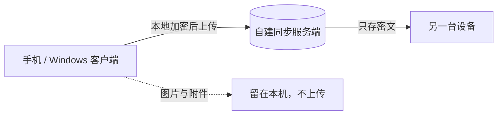
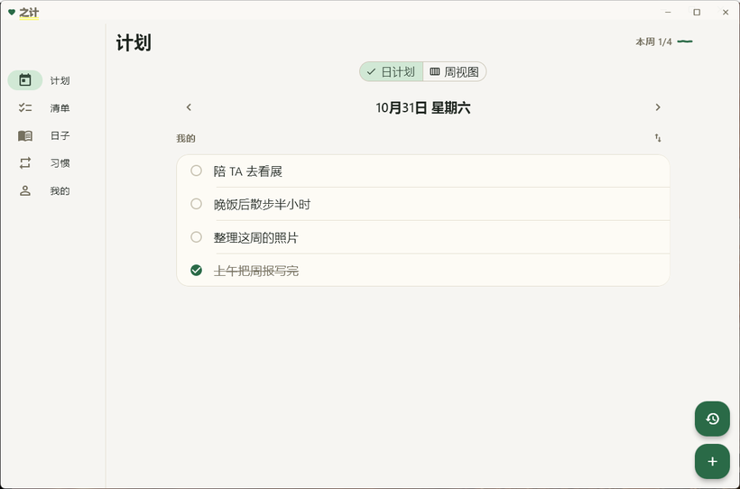
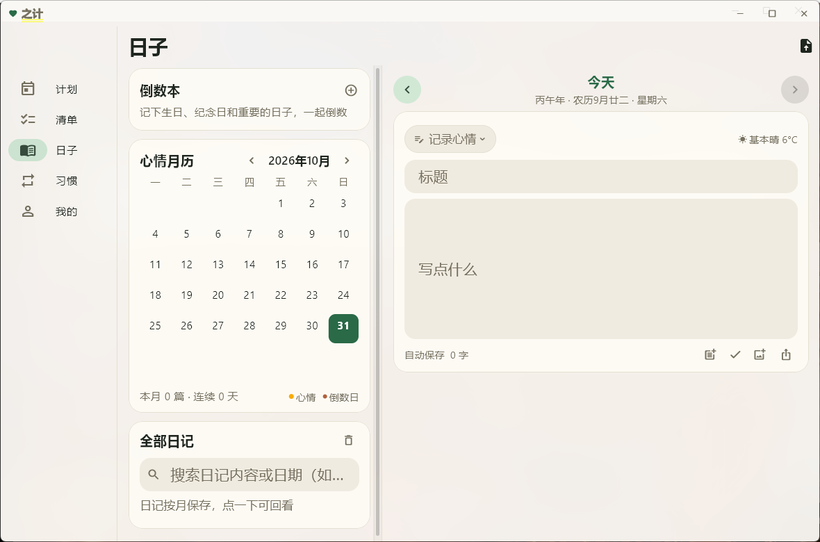

<div align="center">


# 之计

<sub>两个人的手帐风计划应用 · Android + Windows · 自带同步服务端</sub>

[](https://github.com/hauxu/zhiji/releases)
[](#下载)
[](LICENSE)
[](#数据怎么走)

[下载](#下载) · [功能](#功能) · [数据怎么走](#数据怎么走) · [构建](#从源码构建) · [服务端](server/README.md) · [MCP 接口](docs/MCP.md) · [更新日志](assets/CHANGELOG.md) · [隐私政策](PRIVACY.md)

<br>


</div>

## 这是什么

一个给自己和伴侣一起用的小应用。

计划、清单、习惯、日记放在一处：早上打开是今天的安排，晚上合上是这一天的记录。两个人的数据加密同步，服务器只看见密文；图片始终留在本机。同步服务端用 Python 标准库写完，想自己部署就自己部署，不必把日子交给别人的云。

没有账号体系，没有推荐算法，没有「猜你喜欢」。它只做一件事——把手帐搬到屏幕上，顺便让另一半也能看见。

## 功能

<table>
<tr><td width="120"><b>计划</b></td><td>日视图 / 周视图、重复任务、提醒、置顶、拖动排序、完成自动归档；没有日期的计划留在备忘录区长期显示</td></tr>
<tr><td><b>清单</b></td><td>备注、附件、条目日期；可自用，也可共享或与 TA 共同编辑</td></tr>
<tr><td><b>习惯</b></td><td>打卡月历、热力图、每日提醒</td></tr>
<tr><td><b>日子</b></td><td>日记、心情月历、倒数本（支持农历）</td></tr>
<tr><td><b>情侣</b></td><td>扫码配对，共享密钥同步；留言板带已读回执</td></tr>
<tr><td><b>多设备</b></td><td>设备管理、历史分页；换机用恢复码取回数据</td></tr>
<tr><td><b>通知</b></td><td>本地闹钟 + 后台长连接，划掉 App 也能收到</td></tr>
<tr><td><b>外观</b></td><td>中国传统色、深色模式、自定义背景；Windows 支持毛玻璃</td></tr>
<tr><td><b>智能体</b></td><td>内置 MCP 接口，本机智能体可读取计划、清单、习惯、日记，默认只读</td></tr>
</table>

## 数据怎么走



三句话说完：日记用恢复码派生的密钥加密；配对之后的计划、清单、习惯、留言用双方协商出的共享密钥加密；服务器拿到的只有密文。详见 [隐私政策](PRIVACY.md)。

## 截图

<table>
<tr>
<td></td>
<td></td>
</tr>
<tr align="center">
<td><sub>计划 · 日视图与备忘录</sub></td>
<td><sub>日子 · 日记与倒数本</sub></td>
</tr>
</table>

## 下载

| | 文件 | 体积 |
|---|---|---|
| **Android 7.0+** | [`zhiji-5.16.29.apk`](https://github.com/hauxu/zhiji/releases/download/v5.16.29/zhiji-5.16.29.apk) | ≈64 MB |
| **Windows 免安装** | [`zhiji-v5.16.29-windows-portable.zip`](https://github.com/hauxu/zhiji/releases/download/v5.16.29/zhiji-v5.16.29-windows-portable.zip) | ≈38 MB |
| **Windows 安装版** | [`zhiji-5.16.29-windows-setup.exe`](https://github.com/hauxu/zhiji/releases/download/v5.16.29/zhiji-5.16.29-windows-setup.exe) | ≈35 MB |

国内下载走 <https://www.huaxu.xin/zhiji/>，比 GitHub 快，包一模一样。每个发布都附带 `SHA256SUMS.txt`，下载后可自行核对。

装好之后用应用内的「检查更新」就能升级，不用回来重新下载。

## 从源码构建

<details>
<summary>需要的环境与命令</summary>

<br>

Flutter 3.47（Dart 3.13+）、Android SDK 36 + JDK 17；Windows 端还需要 VS2022 的「使用 C++ 的桌面开发」负载。

```sh
flutter build apk --release \
  --dart-define=ZHIZI_SYNC_HOST=your.server.com \
  --dart-define=ZHIZI_SYNC_PORT=8443 \
  --dart-define=ZHIZI_SYNC_APPKEY=<服务端 GD_APP_KEY> \
  --dart-define=ZHIZI_SYNC_CERT=<证书 SHA-256 指纹>
```

四个参数指向你自己的同步服务器。不填也能编译，只是云同步、配对与检查更新不可用。

证书指纹这样取：

```sh
openssl x509 -in sync.crt -noout -fingerprint -sha256
```

Windows 端换成 `flutter build windows --release`，产物在 `build/windows/x64/runner/Release/`。仓库不带 VC++ 运行库，缺的话把 `vc_redist.x64.exe` 放进 `windows/` 再跑 `install_judging.bat`。

</details>

## 自建同步服务端

<details>
<summary>部署方式</summary>

<br>

`server/server.py` 只依赖 Python 标准库，数据就是目录里的几个 JSON 文件——备份等于拷一个文件夹，迁移等于换一台机器。

证书申请、systemd 服务、环境变量、备份与恢复都写在 [server/README.md](server/README.md)。

</details>

## 数据与隐私

- 日记用恢复码派生的密钥加密；配对后的计划、清单、习惯、留言用双方协商出来的共享密钥加密，服务器只存密文
- 明文只有邮箱、昵称、头像、公钥、设备名、纪念日日期
- 日记图片与清单附件不离开本机
- 恢复码丢了日记就解不开；可以用本机数据重建一份备份，但请尽早把恢复码抄下来离线保存
- 完整的收集范围、存储位置与删除方式见 [隐私政策](PRIVACY.md)

## 常见问题

**一定要自己搭服务器吗？**

不一定。不填同步参数也能用，计划、清单、习惯、日记照样记在本机；只是云同步、情侣配对与检查更新不可用。

**两个人的数据怎么同步？**

扫码配对后双方协商出共享密钥，之后各自的改动加密上传，另一台设备拉取解密。服务器全程只看到密文。

**恢复码丢了会怎样？**

加密日记的密钥由恢复码派生，丢了就无法解密。可以先用本机数据重建备份，再把新的恢复码离线存好。

**支持哪些系统？**

Android 7.0 及以上；Windows 提供安装版与免安装版两种。

**怎么升级？**

应用内「检查更新」即可；也可以回到 [Releases](https://github.com/hauxu/zhiji/releases) 下载新包覆盖安装，数据不会丢。

## 更新日志

最近三个版本：

- **v5.16.29** —— 计划页当备忘录用：没有日期的计划不再淹没在周视图里；内置 MCP 接口，本机智能体可读计划、清单、习惯、日记，默认只读
- **v5.16.28** —— Windows 去掉系统标题栏，自绘标题栏与同一层材质
- **v5.16.27** —— Windows 设置新增「浓度」：清透 / 标准 / 通透

完整记录见 [assets/CHANGELOG.md](assets/CHANGELOG.md)。

## 参与

- 缺陷与建议：[Issues](https://github.com/hauxu/zhiji/issues)
- 使用讨论：[Discussions](https://github.com/hauxu/zhiji/discussions)
- 安全问题：请勿公开提 issue，按 [安全策略](SECURITY.md) 私下报告

## 联系

- 网站：<https://www.huaxu.xin/zhiji/>
- 邮箱：<huaxu@huaxu.xin>

## 许可

客户端 GPL-3.0（[LICENSE](LICENSE)），服务端 AGPL-3.0（[server/LICENSE](server/LICENSE)）。第三方组件的许可与应用内「开源许可」一致。

<div align="center">
<br>
<sub>Copyright © 2026 HuaXu</sub>
</div>
