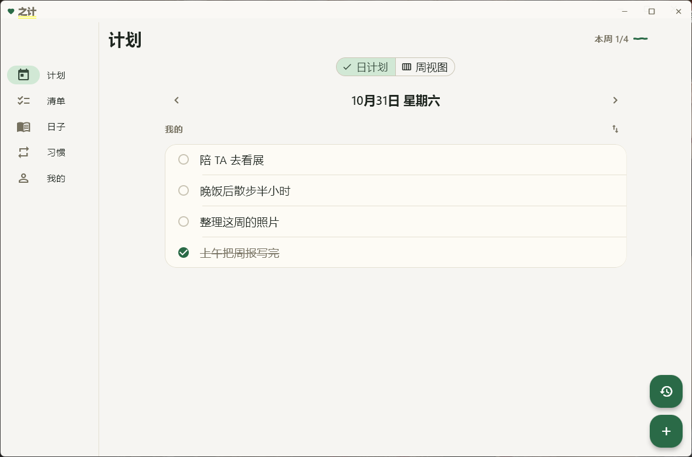

<div align="center">

# 之计

记录两个人的日常：计划、清单、习惯、日记，还有彼此的留言。

[](https://github.com/hauxu/zhiji/releases)
[](#下载)
[](https://flutter.dev)
[](LICENSE)

[下载](#下载) · [功能](#功能) · [构建](#从源码构建) · [服务端](server/README.md)



</div>

## 功能

| | |
|---|---|
| **计划** | 日视图与周视图、重复任务、提醒、置顶、拖动排序、完成的自动归档 |
| **清单** | 备注、附件、条目日期；可以只给自己看，也可以共享或和 TA 一起编辑 |
| **习惯** | 打卡月历、热力图、每日提醒 |
| **日子** | 日记、心情月历、倒数本（支持农历） |
| **情侣** | 配对后用共享密钥同步，「留言板」带已读回执 |
| **多设备** | 设备管理、历史分页；换机用恢复码取回数据 |
| **通知** | 本地闹钟 + 后台长连接，划掉 App 也能收到 |
| **外观** | 中国传统色、深色模式、自定义背景；Windows 支持毛玻璃 |

AI 识别默认关闭。要用的话在「我的 → AI 助手」填一个兼容 OpenAI 的 Key。

## 下载

| 平台 | 文件 | 说明 |
|---|---|---|
| Android 7.0+ | [zhiji-5.16.28.apk](https://github.com/hauxu/zhiji/releases/download/v5.16.28/zhiji-5.16.28.apk) | 66 MB |
| Windows 10/11 | [zhiji-v5.16.28-windows-portable.zip](https://github.com/hauxu/zhiji/releases/download/v5.16.28/zhiji-v5.16.28-windows-portable.zip) | 解压即用，40 MB |
| Windows 10/11 | [zhiji-5.16.28-windows-setup.exe](https://github.com/hauxu/zhiji/releases/download/v5.16.28/zhiji-5.16.28-windows-setup.exe) | 安装到用户目录，36 MB |

国内下载走 <https://www.huaxu.xin/zhiji/>，比 GitHub 稳。校验值在同目录的 `SHA256SUMS.txt`。

应用内「检查更新」可以直接升级。

## 从源码构建

需要 Flutter 3.47（Dart 3.13+）、Android SDK 36 + JDK 17；Windows 还要装 VS2022 的 C++ 桌面负载。

```sh
flutter build apk --release \
  --dart-define=ZHIZI_SYNC_HOST=your.server.com \
  --dart-define=ZHIZI_SYNC_PORT=8443 \
  --dart-define=ZHIZI_SYNC_APPKEY=<服务端 GD_APP_KEY> \
  --dart-define=ZHIZI_SYNC_CERT=<证书 SHA-256 指纹>
```

四个参数对应同步服务器，不填就只能离线用。证书指纹这样取：

```sh
openssl x509 -in sync.crt -noout -fingerprint -sha256
```

Windows 用 `flutter build windows --release`，产物在 `build/windows/x64/runner/Release/`。仓库不带 VC++ 运行库，缺的话自己下 `vc_redist.x64.exe` 放进 `windows/` 再跑 `install_judging.bat`。

## 自建同步服务端

`server/` 只有 Python 标准库，一个进程一个 JSON 文件。部署步骤、环境变量、备份方法都在 [server/README.md](server/README.md)。

## 数据与隐私

- 日记用恢复码派生的密钥加密；配对后的计划、清单、习惯、留言用双方协商的共享密钥加密，服务器只存密文
- 明文只有：邮箱、昵称、头像、公钥、设备名、纪念日日期
- 日记图片和清单附件不离开本机
- 恢复码丢失后日记无法解开，可以用本机数据重建一份备份

## 许可

客户端 GPL-3.0，见 [LICENSE](LICENSE)；服务端 AGPL-3.0，见 [server/LICENSE](server/LICENSE)。
用到的第三方组件和应用内「开源许可」一致。
